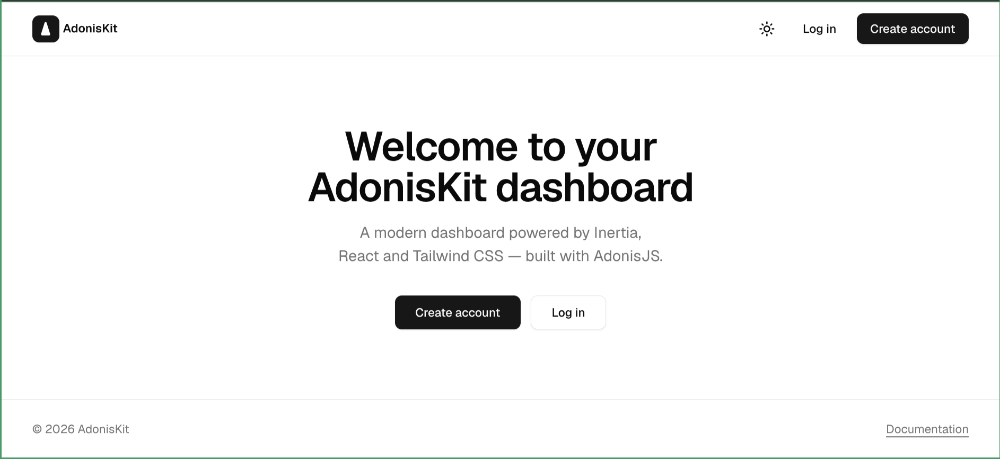
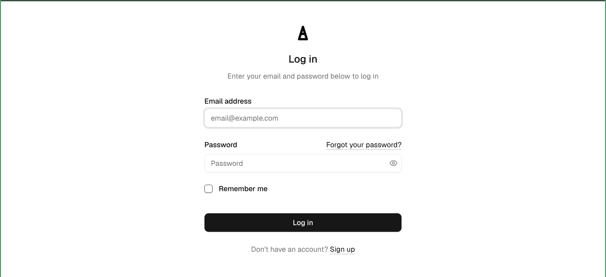
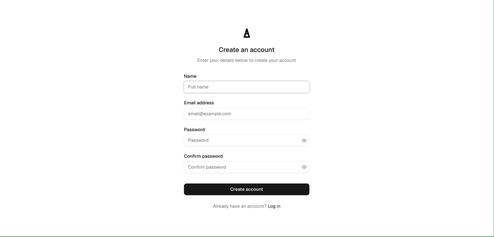
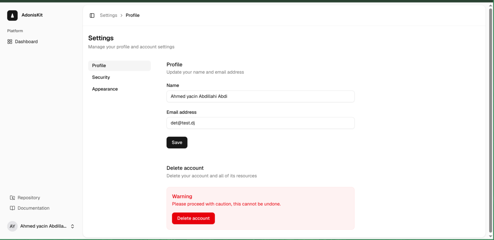
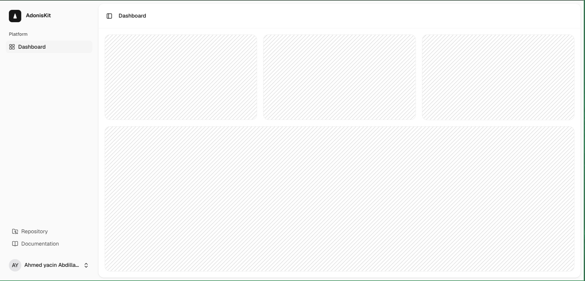

  <h1 align="center">AdonisKit</h1>
  
A production-ready AdonisJS 7 starter kit with Inertia + React, shadcn-style UI on Base UI, and a modern dashboard shell.

  

    
    
    
    
  

---

AdonisKit is a production-ready starter kit for building modern web applications
with AdonisJS 7, Inertia and React 19. It ships with a complete authentication
flow, a shadcn-style UI built on Base UI with Tailwind CSS v4, and a polished
dashboard shell with light and dark mode.

## UI Showcase

### Landing

  

### Authentication

  
  
  

### Dashboard 

  

## Documentation

- [Official Documentation](DOCUMENTATION.md) — getting started, routes, configuration, scripts and more
- [Contributing](CONTRIBUTING.md)

## Code of Conduct

Please read the [Contributor Covenant Code of Conduct](https://www.contributor-covenant.org/version/2/1/code_of_conduct/).

## License

AdonisKit is open-sourced software licensed under the [MIT license](LICENSE).
